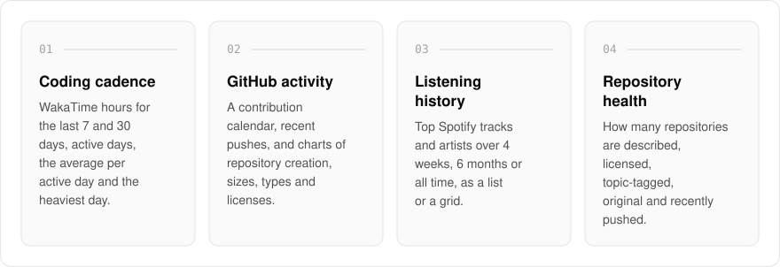
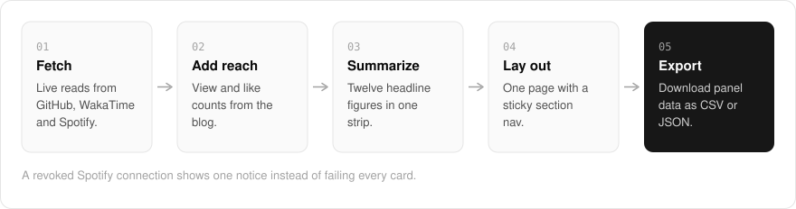

  <picture>
    <source media="(prefers-color-scheme: dark)" srcset=".github/assets/hero-dark.png">
    
  </picture>

<h1 align="center">dashboard.me.at</h1>

<strong>The numbers behind my network: GitHub activity, WakaTime coding hours, Spotify listening, and blog reach.</strong>

  
  
  

  <a href="#features">Features</a> ·
  <a href="#how-it-works">How it works</a> ·
  <a href="#built-with">Built with</a>

My coding hours, GitHub activity, listening and blog reach each live in a different place, and none of them tells the whole story alone. I built dashboard.me.at to gather my personal metrics on one page: it pulls live data from GitHub, WakaTime and Spotify, plus view and like counts from my blog, and lays them out as a single scrolling dashboard. It is a personal quantified-self page, not a product, and it is kept out of search indexes.

  <picture>
    <source media="(prefers-color-scheme: dark)" srcset=".github/assets/overview-dark.svg">
    
  </picture>

## Why

- **One page instead of four tabs**: coding time, repositories, music and blog reach sit side by side, with twelve headline figures up top.
- **Live, not pasted in**: every panel is fed by its source's API rather than typed in by hand, and panel data can be downloaded as CSV or JSON.
- **Fails one card at a time**: a revoked Spotify connection shows one notice instead of breaking every card.

## Features

- **Overview strip**: twelve headline figures (coding time, streaks, repositories, stars, open issues, languages, views, blog likes).
- **Coding cadence**: WakaTime hours for the last 7 and 30 days, active days, average per active day, and the heaviest day.
- **Repository health**: how many repositories are described, licensed, topic-tagged, original, and recently pushed.
- **GitHub metrics**: a contribution calendar, recent pushes, and charts of repository creation, updates, sizes, types, and licenses.
- **Music metrics**: top tracks and artists from Spotify over the last 4 weeks, 6 months, or all time, with list and grid views.
- **Export**: download panel data as CSV or JSON.
- **Mobile-first layout**: a sticky section nav, scroll progress, and print styles.
- **Graceful failure**: a revoked Spotify connection shows one notice instead of failing every card.

## How it works

  <picture>
    <source media="(prefers-color-scheme: dark)" srcset=".github/assets/flow-dark.svg">
    
  </picture>

Each section reads its own source: GitHub for repositories and contributions, WakaTime for coding hours, Spotify for listening, and my blog for view and like counts. The overview strip condenses those into twelve headline figures, and the sections below lay out the detail on one page with a sticky section nav. Any panel's data can be exported as CSV or JSON.

## Built with

  
  
  
  
  
  
  
  

- Next.js 16 (App Router), React 19, TypeScript
- Tailwind CSS 4
- oRPC + TanStack Query
- Recharts, Chart.js, and react-activity-calendar
- GitHub, WakaTime, and Spotify APIs

## Part of the me.at family

dashboard.me.at is one of my [`*.me.at`](https://me.at) apps. They share one design system, account, and app shell. Development happens in a private monorepo; this repository is the project's public-facing home.

## License

Source-available. See [LICENSE](LICENSE).
