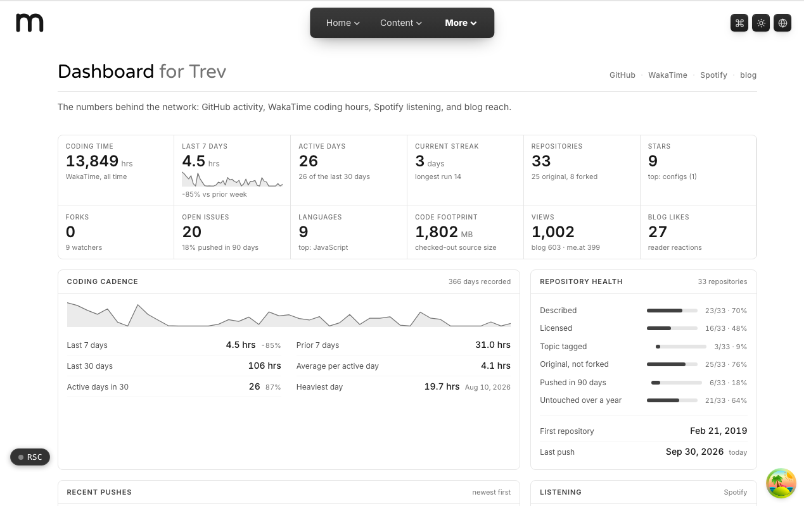

  <picture>
    <source media="(prefers-color-scheme: dark)" srcset=".github/assets/hero-dark.png">
    
  </picture>

# dashboard.me.at

The numbers behind the network: GitHub activity, WakaTime coding hours, Spotify listening, and blog reach.

dashboard.me.at gathers my personal metrics on one page. It pulls live data from GitHub, WakaTime, and Spotify, plus view and like counts from the blog, and lays them out as a single scrolling dashboard. It is a personal quantified-self page, not a product, and it is kept out of search indexes.

**Live:** [dashboard.me.at](https://dashboard.me.at)

## Features

- **Overview strip**: twelve headline figures (coding time, streaks, repositories, stars, open issues, languages, views, blog likes).
- **Coding cadence**: WakaTime hours for the last 7 and 30 days, active days, average per active day, and the heaviest day.
- **Repository health**: how many repositories are described, licensed, topic-tagged, original, and recently pushed.
- **GitHub metrics**: a contribution calendar, recent pushes, and charts of repository creation, updates, sizes, types, and licenses.
- **Music metrics**: top tracks and artists from Spotify over the last 4 weeks, 6 months, or all time, with list and grid views.
- **Export**: download panel data as CSV or JSON.
- **Mobile-first layout**: a sticky section nav, scroll progress, and print styles.
- **Graceful failure**: a revoked Spotify connection shows one notice instead of failing every card.

## Built with

- Next.js 16 (App Router), React 19, TypeScript
- Tailwind CSS 4
- oRPC + TanStack Query
- Recharts, Chart.js, and react-activity-calendar
- GitHub, WakaTime, and Spotify APIs

## Part of the me.at family

dashboard.me.at is one of my [`*.me.at`](https://me.at) apps. They share one design system, account, and app shell. Development happens in a private monorepo; this repository is the project's public-facing home.

## License

See [LICENSE](LICENSE).
